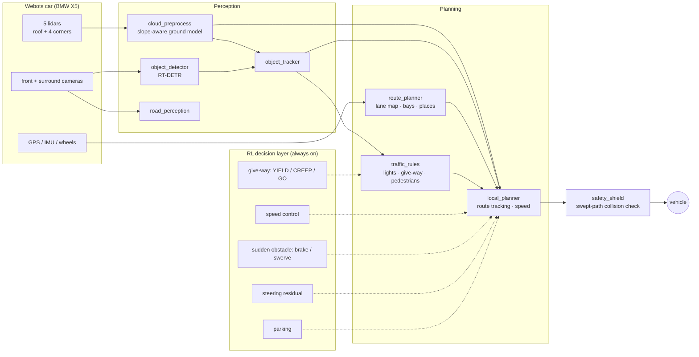

# Autonomous Vehicle — ROS 2 + Reinforcement Learning in Webots

[](https://docs.ros.org/en/jazzy/)
[](https://cyberbotics.com/)
[](https://eclipse.dev/sumo/)
[](https://www.python.org/)
[](https://stable-baselines3.readthedocs.io/)
[](LICENSE)

A self-driving car that drives itself through a simulated village with traffic, traffic lights,
roundabouts, bridges, pedestrians and animals — and parks in a free bay at its destination.
A hand-written planner does the driving; **reinforcement learning makes the decisions** a human
driver makes (when to go at a junction, how to brake, how to react when something appears in
front); a **safety shield** has the final word on every command.

> 🎥 **Demo:** the car drives itself to the hospital and parks — see [`docs/demo/`](docs/demo/)
> (record your own with `tools/record_demo.sh`).

---

## What it does

| | |
|---|---|
| **Drives a route** | lane-level routing on the SUMO road network, stays centred in its own lane (≈ 0.1 m mean error), keeps a steady cruise speed and slows only for curves, traffic and rules |
| **Follows the rules** | traffic lights (camera + V2I signal timing), give-way at junctions and roundabouts, speed limits, yields to pedestrians |
| **Handles traffic** | 40 SUMO vehicles around it, following distance, cut-ins, vehicles braking suddenly |
| **Thinks in situations (RL)** | when to enter a junction, how hard to brake, whether to swerve round a sudden obstacle |
| **Parks** | shows every bay on the map (free / taken, sensed live by the lidar), you click one — or it picks the nearest free bay at the destination — and parks in it |
| **Watches the driver** | an unresponsive driver triggers warnings, then an emergency drive to the nearest hospital |

## Architecture



**Layers, from slow to fast:** route (`route_planner`, lane map from the SUMO network) →
rules (`traffic_rules`) → local planning (`local_planner` + `auto_car_core/planner.py`: tracks the
route with a lag-aware connector + pure pursuit, in-lane nudging, curve speed) → the RL layer
adjusts decisions and commands → `safety_shield` checks the swept path of every command against
the raw lidar and brakes if needed.

## Reinforcement learning — where and why

RL is used where rules are either too cautious or too brittle, **never as the last line of
safety**. Every policy is wrapped by hard rules outside it, trained in a fast environment that
mirrors the car's real observation (unit tests check that the training and runtime observations
match), and compared against the behaviour it replaces.

| Policy | Decides | Algorithm | Hard rules around it | Result vs. the previous rule |
|---|---|---|---|---|
| **Give-way** (`rl/decision_env.py`) | YIELD / CREEP / GO at junctions and roundabout entries | PPO | GO only into a gap the car can physically clear; committed once it cannot stop before the line | cleared **96 %** vs 87 %, waits that time out 17 vs 53, 0 collisions |
| **Speed** (`rl/speed_env.py`) | acceleration towards the planner's target speed | SAC | never above the target speed; shield brakes in emergencies | 0 collisions, half the emergency brakes, p99 braking **1.9 vs 3.0 m/s²**, 30 % less jerk |
| **Sudden obstacle** (`rl/evade_env.py`) | braking + lateral target when something appears in the lane | SAC | stays on the road; never over the centre line with oncoming traffic < 4 s away | collisions **8 vs 25**, emergency-brake episodes 52 vs 225, gets past 57 % vs 40 % |
| **Steering residual** (`rl/steer_env.py`) | ±0.05 rad on top of the planner, trained on the 138 real routes of the map | SAC | the planner does the steering; residual bounded | mean lane error 0.133 → **0.120 m**, 7 % less zig-zag |
| **Parking** (`rl/park_env.py`) | steering + forward/reverse speed into a parallel bay | SAC + HER, reverse curriculum | only promoted after passing evaluation; geometric manoeuvre otherwise | *in training* |

Train / evaluate any of them in minutes:

```bash
python3 rl/train_decision.py && python3 rl/eval_decision.py --policy rl/models/giveway_ppo.zip
python3 rl/train_speed.py    && python3 rl/train_speed.py --eval rl/models/speed_sac.zip
python3 rl/train_evade.py    && python3 rl/train_evade.py --eval rl/models/evade_sac.zip
python3 rl/train_steer.py    && python3 rl/train_steer.py --eval rl/models/steer_sac.zip
python3 rl/train_park.py     && python3 rl/train_park.py  --eval rl/models/park_sac_her.zip
```

## The world

A village built for testing (`worlds/village.wbt` + `worlds/village_net/`): crossroads with real
kerb returns, a roundabout, two bridges on solid brick embankments, cul-de-sacs with turning
islands, a highway ring, 27 traffic lights, bus stops, two car parks (16 bays), 11 walking
pedestrians and 16 animals, SUMO traffic that drives over the bridges at the right height.
Every edit is a reproducible script in `tools/` (rounding corners, connecting dead ends, placing
signs where they belong, clearing buildings off roads, …) — see [Tools](#tools) below.

## Quick start

Requirements: Ubuntu 24.04, ROS 2 Jazzy, Webots R2025a, SUMO ≥ 1.20, Python 3.12,
`stable-baselines3`, `gymnasium`, `torch`, `ultralytics`.

```bash
mkdir -p ~/auto_ws/src && cd ~/auto_ws/src
git clone https://github.com/Docprox-pixel/Autonomous-Vehicle-using-ROS2-and-Reinforcement-Learning.git auto_car
cd ~/auto_ws
rosdep install -i --from-path src --rosdistro jazzy -y
colcon build --symlink-install && source install/setup.bash

# detector weights (not stored in git)
cd src/auto_car/models && python3 -c "from ultralytics import RTDETR; RTDETR('rtdetr-l.pt')" && cd -

# run (tools/sim/start.sh does a clean restart and waits until the car is ready)
src/auto_car/tools/sim/start.sh run1 world:=village.wbt rviz:=true
```

Then, in another terminal:

```bash
python3 tools/driver_vitals.py normal 1800        # simulated driver: hands on the wheel
ros2 topic pub --once /route/go_to std_msgs/msg/String "{data: 'hospital'}"   # or any place
```

Or click **2D Goal Pose** in RViz — on a road to drive there, **on a parking bay to park in it**
(bays are drawn green = free, red = taken, blue = selected).

## Repository layout

```
auto_car_core/   planner, lane map, live map, safety, ground model, RL runtime modules
scripts/         ROS 2 nodes (perception, route, rules, local planner, shield, driver monitor)
auto_car_sim/    Webots vehicle bridge
controllers/     Webots controllers (SUMO supervisor with bridge heights + demo recording, lights)
rl/              RL environments, training and evaluation, trained policies (rl/models/*.zip)
worlds/          Webots worlds and their SUMO networks, POIs, parking bays, signal maps
tools/           world-building, auditing and test-drive tools
test/            unit tests (pytest) and live tests
config/          sensor layout, RViz configs
```

## Tools

| Tool | Purpose |
|---|---|
| `tools/audit_turns.py` | drives every turn of the network in closed loop with the real planner; checks curvature, lane deviation and straight approach/exit |
| `tools/drive_trace.py` | records a live drive: lane error, steering, nudges, every stop with the rule / shield reason |
| `tools/record_demo.sh` | records the demo video (Webots renders it) and makes a LinkedIn-ready copy |
| `tools/rebuild_network.py`, `tools/net_heights.py` | rebuild the SUMO network consistently; give bridges / ramps their heights |
| `tools/round_corners.py`, `tools/clear_corners.py`, `tools/place_signs.py`, `tools/clear_buildings.py`, `tools/bridge_embankments.py`, `tools/add_life.py` | world building: kerb returns, signs and lights where they belong, buildings off roads, solid bridges, pedestrians and animals |

## Tests

```bash
python3 -m pytest -q test --ignore=test/pedestrian_test.py    # 78 unit tests
```

Live tests (`test/*_test.py`) run against a running simulation (braking, junctions, signals,
pedestrians, driver emergency).

## License

Apache 2.0 — see [LICENSE](LICENSE).

---
*Developed by [Aryan Yadav](https://www.linkedin.com/in/aryan-yadav-1858632b5)*
